# Issuer Intelligence Hub

**Decode your share price: AI-powered Xetra trading insights for investor relations.**

Futury Build Days 2026 · Deutsche Börse challenge *"Issuer Intelligence Hub and corporate event impact tracker"*

🥈 **2nd place – Deutsche Börse Challenge, Futury Build Days 2026 (Frankfurt)**

**Team 9:** [Oğuzhan](https://github.com/Bthn28) · [Alper](https://github.com/alpercakiroglu05-arch) · [Kaan](https://github.com/ydnka)


> Deutsche Börse trading data is not included in this repository.
---

## Table of contents

1. [The problem in a nutshell](#1-the-problem-in-a-nutshell)
2. [What the tool does](#2-what-the-tool-does)
3. [Quick start (command line)](#3-quick-start-command-line)
4. [Architecture](#4-architecture)
5. [Data sources](#5-data-sources)
6. [Data preprocessing](#6-data-preprocessing)
7. [The event calendar](#7-the-event-calendar)
8. [The engine: metrics and baselines](#8-the-engine-metrics-and-baselines)
9. [The AI layer](#9-the-ai-layer)
10. [Web front end and JSON API](#10-web-front-end-and-json-api)
11. [Reports and offline snapshot](#11-reports-and-offline-snapshot)
12. [Configuration](#12-configuration)


---

## 1. The problem in a nutshell

Investor Relations (IR) teams must explain share price moves, liquidity and the trading profile, internally and externally.
Large caps have terminals and analysts for that. **Most mid and small caps have neither.** They rely on public websites and
periodic broker reports that lag the market and cost extra for every analysis. Simple questions go unanswered for days:

- *Has our liquidity improved?*
- *How do our spreads compare with peers?*
- *Did trading change after our results?*

This project answers them in seconds, from Deutsche Börse's own Xetra data, without a terminal and without an analyst.

## 2. What the tool does

| Part | Question it answers | What you get |
|---|---|---|
| **A. Dashboard** | *"How does our share normally trade?"* | Turnover, trading cost (XLM spread, also by order size), auction share, who trades (market maker / agent / proprietary), peers by index, sector and size, liquidity trend, unusual days with the linked announcement and market context, exportable as a short IR report (DE/EN) |
| **B. Impact card** | *"What happened when we announced X?"* | Move vs. peers, volume vs. normal, spread, opening and closing auction vs. normal, participant flows, the minute the market started pricing the news, rank among events of the same type, exportable as an "IR snapshot" (DE/EN) |
| **Compare** | *"Is that reaction typical?"* | All events of the same type (e.g. all full-year results) across DAX / MDAX / SDAX, ranked |
| **Assistant** | *"Explain this to me."* | An AI analyst that answers questions by calling the engine, so every number comes from the data |

Design rule: **every number comes from the engine; the language model only writes the words.**
A checker rejects any AI text that contains a figure that is not in the underlying card.

## 3. Quick start (command line)

### 3.1 Requirements

- Python 3.10+ (the code uses `X | None` type syntax)
- `pip install -r requirements.txt` (pandas, numpy, pyarrow, duckdb, ...)
- Optional: `xhtml2pdf` for PDF export (without it, reports are delivered as HTML)

```bash
python -m venv .venv
source .venv/bin/activate            # Windows PowerShell: .venv\Scripts\Activate.ps1
pip install -r requirements.txt
```

### 3.2 Get the processed data

The web app needs the small processed files in `data/`. You have two options.

**Option A: copy them (fastest).** Take the finished `data/` folder from the team OneDrive/SharePoint and put it in the repo root.
It is shared inside the team only and never committed.

**Option B: rebuild from the raw Deutsche Börse excerpt (8.9 GB).** Run the ingest scripts in this order:

```bash
# 1. Daily layer: daily_features.parquet, universe.csv, hero_candidates.csv
python ingest/build_daily.py "<RAW_DIR>" data

# 2. Event calendar: events/events.csv -> data/events.parquet  (needs step 1)
python ingest/build_events.py

# 3. 1-minute bars from every Xetra trade -> data/intraday_bars.parquet  (needs steps 1 and 2)
python ingest/build_intraday.py --raw "<RAW_DIR>"            # ~160 s, resumable

# 4. Sectors (optional): events/sectors.csv from Deutsche Börse's "Listed companies" xlsx
python ingest/build_sectors.py <path-or-url-to-Listed-companies.xlsx>
```

`<RAW_DIR>` is the extracted excerpt, which must contain:

```
<RAW_DIR>/
  index_constituents/*_CONSTITUENTS_*.csv.gz
  XETRA/XETRA_OHLC/*.csv.gz
  XETRA/XETRA_FLOW_DYNAMICS_EQUITY/*.csv.gz
  XETRA/XETRA_ONBOOK_TRADES/XETRA_ONBOOK_TRADES_*.csv.gz
  dax_mdax_sdax_liquid_spreads*.tgz
```

Windows PowerShell, setting the raw folder once instead of passing `--raw`:

```powershell
$env:IIH_RAW_DIR = ".\Futury MDS Data Excerpt"
python ingest/build_intraday.py
```

Useful flags of `build_intraday.py`:

| Flag | Effect |
|---|---|
| `GXI EVD` (positional) | process only these tickers instead of every stock in `events.csv` plus the hero stocks |
| `--max-seconds 150` | stop after about 150 s; run again to continue where it stopped |
| `--rebuild` | ignore existing day parts and start over |

### 3.3 Start the web app

```bash
python web/server.py                       # http://127.0.0.1:8600
python web/server.py --port 9000 --host 0.0.0.0
```

The server refuses to start without `data/daily_features.parquet` and prints `No processed data in <DATA_DIR>`. On start it warms up the engine caches
(`universe`, `compare.stock_medians`, `compare.metrics_all`) before it serves requests.

### 3.4 Optional: switch on the language model

Add to `.env` in the repo root (the key stays on the server; the browser never sees it):

```
LLM_PROVIDER=<provider>
LLM_API_KEY=<your key>
```

Without a key the AI summary and the assistant fall back to deterministic templates, and the header shows **"AI: template mode"**.
Nothing else changes: all figures are identical in both modes.

## 4. Architecture

```mermaid
flowchart LR
    RAW["Raw Xetra excerpt<br/>OHLC · Flows · Trades · XLM · Index constituents"] --> ING
    CAL["events/events.csv<br/>(hand-maintained)"] --> ING
    LISTED["Deutsche Börse<br/>Listed companies xlsx"] --> ING

    subgraph ING["ingest/ (run once)"]
        D[build_daily.py]
        E[build_events.py]
        I[build_intraday.py]
        S[build_sectors.py]
    end

    ING --> DATA[("data/<br/>daily_features.parquet<br/>universe.csv · events.parquet<br/>intraday_bars.parquet<br/>events/sectors.csv")]

    DATA --> ENG

    subgraph ENG["engine/ (all numbers)"]
        BL[baseline]
        IM[impact]
        CP[compare]
        MK[market]
        XL[xlm]
        EV[evidence]
        ON[onset]
    end

    ENG --> AI["ai/<br/>narrate · agent · intel · checks"]
    ENG --> REP["report/<br/>PDF · HTML export"]
    ENG --> SRV
    AI --> SRV["web/server.py<br/>JSON API (stdlib only)"]
    REP --> SRV
    SRV --> UI["web/ index.html · app.css · app.js<br/>dashboard · impact card · compare · assistant · report"]
    SRV --> SNAP["web/snapshot.py<br/>one offline .html file"]
```



### 4.1 Layers

| Layer | Folder | Responsibility |
|---|---|---|
| Configuration | `config.py` | Paths, hero stocks, session times, every threshold. Import from here, never hard-code. |
| Ingest | `ingest/` | Turn 8.9 GB of raw files into a few small parquet/csv files. Runs once. |
| Engine | `engine/` | All statistics: baselines, impact card, peer benchmark, comparisons, liquidity trend, onset detection, evidence. Pure functions over the processed data. |
| AI | `ai/` | Words only: narration, analyst agent (tool calling over the engine), market-intelligence layer, number checker. |
| Report | `report/` | IR snapshot (impact card) and Part A report as PDF/HTML, DE and EN. |
| Web | `web/` | Single-page app and a small JSON API on top of the engine. |

### 4.2 Principles

- **One source of truth.** The dashboard, impact card, report and assistant all call the same engine functions
  (for example `compare.day_ratios` is *the* "x normal" everywhere), so numbers never disagree between screens.
- **Numbers from the engine, words from the model.** `ai/checks.py` rejects a model draft if it contains a number
  that is not in the card; the UI label ("source") then honestly shows whether the user sees the model's text or the template.
- **No new dependencies for the server.** `web/server.py` uses the standard library (`http.server`) on top of the engine's requirements.
- **Graceful degradation.** No LLM key: templates. No XLM (stock left the index): the cost curve is hidden. No intraday bars: the card works without the minute chart. No sector: peers fall back to the index.

### 4.3 Repository layout

```
config.py                 central configuration
ingest/                   build_daily.py · build_events.py · build_intraday.py · build_sectors.py
engine/                   baseline · compare · data · evidence · impact · market · xlm · onset
ai/                       llm · narrate · agent · intel · checks
report/                   export · fmt · template.html
web/                      server.py · snapshot.py · index.html · app.css · app.js
events/                   events.csv (hand-maintained) · sectors.csv · names.csv
data/                     processed files (shared via OneDrive, never committed)
tests/                    
docs/                     API_CONTRACT.md · C2_ENGINE.md · REQUIREMENTS.md
```

## 5. Data sources

All trading data is the Deutsche Börse excerpt for **every DAX, MDAX and SDAX member of 2026** (174 distinct ISINs, 213 trading days).

| Dataset | Content | Used for |
|---|---|---|
| `index_constituents` | Index membership per day | Universe, index peers, `idx_latest` |
| `XETRA_OHLC` | Daily prices, auction prices and times, turnover, VWAP | Prices, returns, turnover, auctions |
| `XETRA_FLOW_DYNAMICS_EQUITY` | Previous day's trading by participant (market maker / agent / proprietary), mode (aggressive / passive / auction) and side (buy / sell) | Who traded, auction share, imbalance |
| `XETRA_ONBOOK_TRADES` | Every single trade (1.7 GB gz, 213 daily files) | 1-minute bars, aggressor split, news-onset detection |
| `dax_mdax_sdax_liquid_spreads` | XLM: impact in basis points for a range of order sizes (EUR 10k to 30m) | Trading cost, spread movement, cost curve |
| `events/events.csv` | Public corporate event calendar (results, dividends, AGM, ad hoc, M&A, ...) | Impact cards |
| Deutsche Börse "Listed companies" | Prime Standard sector per ISIN | Sector peers |

## 6. Data preprocessing

### 6.1 `build_daily.py` — the daily layer

One row per stock per trading day for every index member, written to `data/daily_features.parquet`, plus `universe.csv` (one row per stock) and `hero_candidates.csv` (the 60 strongest stock-specific days in MDAX/SDAX).

The script works with DuckDB (2 threads, 2 GB memory limit, so it runs on a laptop) and follows these steps:

1. **Index membership → universe.** Distinct ISINs from all constituent files.
2. **OHLC.** EUR equity lines of the universe only. If an ISIN has several lines on a day, keep the one with the highest turnover.
3. **Flows.** Flatten MM / AGENT / PROP × AGGRESSIVE / PASSIVE / AUCTION × BUY / SELL into 18 columns.
4. **XLM.** Unpack the `.tgz`, pivot impact in bps per order size into columns `xlm_25k`, `xlm_100k`, `xlm_1m`, ...
5. **Membership per trading day.** A missing constituent file uses the previous trading day's file (`merge_asof`).
6. **Assemble and derive features** (see 6.3).
7. **Write outputs.**

### 6.2 Data pitfalls handled

These are traps in the raw files (documented in the `NOTES.md` of each folder) and how the pipeline treats them:

| Pitfall | Treatment |
|---|---|
| Flow `DATE` is the **publication** date | The real trading day is `REPORTED_FLOW_DATES` |
| Censored flow days (< 7 executions) are empty | Kept as missing, flagged `flow_censored` |
| Multi-day flow rows cannot be split | Excluded from single-day rows, flagged `flow_multi_day` |
| Flow `VOLUME` is **two-sided** (buyer + seller) | Only the one-sided BUY/SELL columns are used (`flow_total_eur` = sum of buys) |
| OHLC open/high/low/close are quoted **mid prices** | Returns use the **closing-auction price**, fallback to the last mid. `ADJUSTED_PRICE` is ignored |
| An ISIN can have several currency lines | EUR only |
| Trade `FACT_TIMESTAMP` is **UTC** | Converted to Europe/Berlin (DST aware) |
| Trade `SIDE`: 1 = aggressive buy, 2 = aggressive sell, empty = auction | Mapped to `aggr_buy_eur`, `aggr_sell_eur`, `auction_eur` |
| Index membership files missing for some days | Previous available file is used |
| XLM exists only while a stock is an index member | `member_now` flag; the dashboard hides the curve otherwise |
| Splits and similar corporate actions | `possible_corp_action` when `|ret| > 40 %`; excluded from hero candidates |
| ISIN changes in 2026 (FRE, QIA, ACT, VRV) | `SAME_COMPANY` mapping in `build_sectors.py`; `build_intraday.py` collects every ISIN of a ticker |

### 6.3 Derived features (per stock and day)

| Feature | Definition |
|---|---|
| `price` | Closing-auction price, fallback to the last mid |
| `ret` | `price / previous price − 1` |
| `gap_open` | Opening-auction price vs. previous close (news before the open) |
| `ret_intraday` | Close vs. opening-auction price (move during the session) |
| `peer_ret` | Equal-weighted return of the *other* members of the same index that day |
| `market_ret` | Same, across all stocks |
| `abn_ret` | `ret − peer_ret` (abnormal return) |
| `vol_ratio` | Turnover ÷ rolling 60-day median turnover |
| `vol_z` | Z-score of log turnover against the previous 60 days |
| `abn_ret_z` | `abn_ret` ÷ rolling std of `abn_ret` |
| `xlm_25k_ratio`, `xlm_100k_ratio` | Spread vs. its own 60-day median |
| `auction_share` | Auction buys ÷ total buys; also `auction_share_med60` |
| `mm_share`, `agent_share`, `prop_share` | Participant share of total flow |
| `agent_aggr_imbalance` | `(aggr buy − aggr sell) / (aggr buy + aggr sell)`; +1 means only buying |
| `flow_censored`, `flow_multi_day`, `possible_corp_action` | Data-quality flags |

All rolling baselines use the **previous 60 trading days with the current day excluded** (minimum 20 observations), so an event can never pollute its own baseline.

### 6.4 `build_intraday.py` — 1-minute bars

Reads every single Xetra trade of the event stocks and writes `data/intraday_bars.parquet`, one row per stock per minute:
`open, high, low, close, shares, volume_eur, n_trades, vwap, aggr_buy_eur, aggr_sell_eur, auction_eur, is_auction`.

- **Resumable.** Each trading day is written to `data/intraday_parts/<YYYYMMDD>.parquet` and skipped on the next run. A `TICKERS.txt` tag invalidates the parts when the ticker set changes.
- **Default tickers:** every ticker in `events/events.csv` plus the hero stocks; unknown tickers abort with a clear message.
- **Fast reads.** The final file is sorted by stock and written with small row groups, so `engine.data.intraday(isin)` reads only that stock's row groups.
- Trading runs about 08:00–22:00 local; everything is kept and consumers filter the session (the card shows 08:55–17:40).

### 6.5 `build_sectors.py` — peer sectors

Maps Deutsche Börse's Prime Standard sectors to **11 groups** (Automotive, Financials, Healthcare, Technology, Media & Telecom, Consumer, Industrials, Materials, Transport & Logistics, Utilities, Real Estate). "Financial Services" with sub-sector "Real Estate" becomes Real Estate.
It reads the xlsx with the standard library only (no `openpyxl`). ISINs missing from the file stay **blank** (no guessing) and fall back to the index in `engine.compare`.

## 7. The event calendar

`events/events.csv` is maintained **by hand** from public sources (company IR pages, Deutsche Börse, news).

| Column | Rule |
|---|---|
| `ticker`, `isin`, `title` | `isin` may be empty; it is then looked up from the ticker |
| `type` | `FY`, `Q1`, `H1`, `Q3`, `DIVIDEND_EX`, `AGM`, `ADHOC`, `GUIDANCE`, `MA`, `CMD`, `INDEX` |
| `date` | `YYYY-MM-DD`, between 2026-01-02 and 2026-10-30 |
| `time_local` | empty or `HH:MM`, Frankfurt time |
| `source_url` | required, starts with `http` |
| `verified` | `0` or `1` |

`build_events.py` turns the CSV into `data/events.parquet` and adds:

- **`timing`**: `pre_open` (before 09:00), `intraday` (09:00 to 17:35), `post_close` (from 17:35), or `unknown` (no time given).
- **`reaction_day`**: the first trading day on which the market could react. A `post_close` event, or an event on a weekend or holiday, reacts on the **next trading day**.
- **`event_id`**: `TICKER_TYPE_YYYYMMDD`, for example `EVD_FY_20260326`. Duplicates are dropped.
- Events with an unknown ticker are dropped with a warning.

Users can also **import their own calendar** in the web app (`POST /api/calendar`); those events are matched to trading days on the fly without touching `events.csv`.

## 8. The engine: metrics and baselines

The engine reads only the processed files and never the raw data. The main building blocks:

| Module | What it provides |
|---|---|
| `engine/data` | Cached access to daily features, universe, events, intraday bars |
| `engine/baseline` | Stock profile, KPIs, index benchmark, liquidity trend, anomaly episodes |
| `engine/impact` | `impact_card(isin, day, event)`: the core output of Part B |
| `engine/compare` | Peer medians (index, sector, size), same-type event tables, `day_ratios` (the canonical "x normal") |
| `engine/market` | Dashboard in one call: header, tiles, timeline, you vs. market, big market days |
| `engine/xlm` | Trading cost curve by order size and its summary |
| `engine/onset` | Minute at which the market started pricing the news |
| `engine/evidence` | Evidence brief behind each card, for the explanation check |

### 8.1 Key parameters (`config.py`)

| Parameter | Value | Meaning |
|---|---|---|
| `BASELINE_DAYS` | 60 | Length of the "normal" window |
| `BASELINE_GAP` | 5 | Skip t−5..t−1 so a pre-event run-up does not pollute the baseline |
| `CAR_DAYS` | 5 | Cumulative abnormal return over t0..t+5 |
| `SPREAD_NORMAL_TOL` | 1.2 | Spread counts as "back to normal" at ≤ 1.2× baseline |
| `ANOMALY_Z` | 3.0 | Threshold for unusual days |
| `LIQUIDITY_TREND_TOL` | 10 % | A change of more than ±10 % in XLM or turnover counts as a move |
| `COMPARE_MIN_GROUP` | 5 | Smallest group worth a percentile |
| `SIZE_COHORT_DAYS`, `SIZE_COHORT_LABELS` | 60, large/mid/small | Size = turnover terciles (market cap is not in the data) |
| `MIN_PEER_GROUP` | 3 | Fewer peers → flagged `small_peer_group` |
| `MARKET_WIDE_VOL_RATIO`, `MARKET_WIDE_SHARE` | 2.0, 25 % | A day is "market-wide" when ≥ 25 % of all stocks trade > 2× normal |
| `ONSET_PRICE_K` | 2.0 | Price move ≥ 2× daily return std |
| `ONSET_VOLUME_K` | 3.0 | Cumulative turnover ≥ 3× normal for that time of day |
| `ONSET_MIN_TURNOVER_SHARE` | 1 % | ... and ≥ 1 % of a normal day (ignores single odd prints) |
| `ONSET_PERSIST_MIN` | 5 | Price still beyond the threshold 5 minutes later |
| `ONSET_OPEN_WINDOW_MIN` | 15 | A break in the first 15 minutes means the news was out before the open |
| `DS_XLM_MAX_BPS`, `DS_TURNOVER_MIN_EUR`, `DS_LOOKBACK_DAYS` | 100 bps, EUR 2.5m, 84 d | Designated Sponsor category thresholds (Being Public Guide) |

### 8.2 What the impact card contains

For one stock and one reaction day: the abnormal return vs. peers, turnover vs. baseline, XLM spread vs. baseline, opening and closing auction vs. normal, participant flows, the news-onset minute, cumulative abnormal return and an "aftershocks" series (t−5 to t+15), and the **rank among events of the same type**.
The web API adds 1-minute bars and the previous close so the card can plot the intraday move.

## 9. The AI layer

| Module | Role |
|---|---|
| `ai/llm` | Provider access; `available()` is false without a key |
| `ai/narrate` | Writes the card summary (EN/DE). Uses the model's text only if the check passes, otherwise the deterministic template |
| `ai/checks` | Every number in a draft must exist in the card; otherwise the draft is rejected |
| `ai/agent` | IR analyst: tool calling over the engine, with page context and chat history; returns text, source, steps, actions and the check result |
| `ai/intel` | "Why did it happen?" from cited sources plus engine figures. Only the demo companies have a research pack; others return `{"result": null}` |

Every response carries a `source` (`llm` or `template`) and a `model` field, so the UI label is always honest.

## 10. Web front end and JSON API

### 10.1 Front end

The demo UI uses the Deutsche Börse look (navy `#000099`, sky `#0099ff`, News Gothic → Archivo). Pages: ISIN entry, dashboard, impact card, compare, assistant, report, ideas.
Charts are hand-written SVG, so there is no chart library. URLs are shareable:

```
#/<ISIN>/<page>[/<day>/<event_id>]
#/DE0005470306/card/2026-03-27/EVD_FY_20260326
```

| File | What |
|---|---|
| `web/server.py` | Static files plus the JSON API (standard library only) |
| `web/index.html` | Shell: ISIN entry and the company workspace |
| `web/app.css` | Design tokens, layout, transitions |
| `web/app.js` | Pages, charts, the AI numbers check, report builder |

### 10.2 API

| Endpoint | Purpose |
|---|---|
| `GET /api/status` | Data folder, stock count, LLM status |
| `GET /api/universe` | All 174 shares for the ISIN entry |
| `GET /api/issuer?isin=` | Trading profile: series, index medians, KPIs, liquidity trend, peers, cost curve, unusual days, events |
| `GET /api/dashboard?isin=&period=1m\|3m\|6m\|ytd\|1y\|all` | The dashboard in one call (`engine.market`) |
| `GET /api/card?isin=&day=&event_id=` | Impact card, 1-minute bars, aftershocks. Add `&date=&time=&type=&title=` for a user-added event |
| `GET /api/compare?type=&index=` | Same-type events, optionally for one index |
| `GET /api/evidence?isin=&day=&event_id=` | Evidence brief and explanation check |
| `GET /api/export?isin=&day=&event_id=&lang=` | IR report as PDF: with `day` the impact-card snapshot, without it the Part A report. Optional `peer_by=index\|sector\|size` |
| `POST /api/calendar` | Match the company's own calendar to trading days |
| `POST /api/narrate` | AI summary of a card (model or template) |
| `POST /api/agent` | IR analyst agent |
| `POST /api/ask` | Same agent, short answer (v1 contract) |
| `POST /api/intel` | Market-intelligence layer ("why") |

All responses are JSON with `NaN`/`Inf` cleaned out (`clean()`); errors return `{"error": ...}` with a 4xx status.

## 11. Reports and offline snapshot

**IR report (PDF).** One click in the app, or `GET /api/export`. Two variants: the impact-card **IR snapshot** with its checked summary, and the **Part A report** of the dashboard. German and English.
PDF needs `xhtml2pdf`; without it the server returns the same report as HTML.

**Offline snapshot.** For people who do not run the server (teammates, mentors, the jury):

```bash
python web/snapshot.py                      # -> ~/Desktop/Issuer-Intelligence-Hub.html (hero stocks)
python web/snapshot.py --tickers EVD HDD    # other shares
python web/snapshot.py --llm                # AI texts from the model in .env instead of templates (slower)
python web/snapshot.py --out path/to/file.html
```

It produces **one self-contained `.html` file** that opens with a double click: the page (HTML, CSS and JS inlined) plus the JSON answer of every API call the demo makes for the chosen stocks
(overviews for 1M/3M/YTD, every impact card, comparisons, AI summaries in EN and DE, suggested analyst questions, evidence briefs).
A small `fetch()` shim answers from that JSON.
Not included: other stocks, free-typed analyst questions and the own-calendar import (they need the live server; the page says so).

> The snapshot contains processed Deutsche Börse data. Share it inside the team only and never commit it.

## 12. Configuration

| Setting | Where | Default |
|---|---|---|
| `IIH_DATA_DIR` | environment | `<repo>/data` |
| `IIH_RAW_DIR` | environment | the folder **above** the repo |
| `LLM_PROVIDER`, `LLM_API_KEY` | `.env` | unset → template mode |
| Host and port | `web/server.py --host --port` | `127.0.0.1:8600` |
| Hero stocks | `HERO_TICKERS` in `config.py` | `EVD` (CTS Eventim), `EVT` (Evotec), `HDD` (Heidelberger Druck) |
| Default ticker | `DEFAULT_TICKER` | `EVD` |

`.env` is read by `config.py` (UTF-8, also tolerates the ANSI files that some Windows editors write); real environment variables win over `.env`.


---

*Built at Futury Build Days 2026, Deutsche Börse challenge.*
